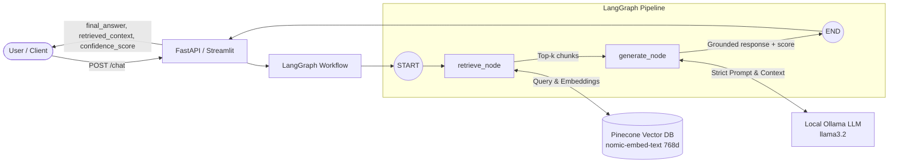

# Grounded RAG Chatbot with LangGraph, Pinecone & Open-Source LLMs

A stateful Retrieval-Augmented Generation (RAG) chatbot designed to strictly answer queries based on the **Agentic AI eBook**. Built using **LangGraph**, **Pinecone**, **Ollama (`llama3.2` & `nomic-embed-text`)**, **FastAPI**, and **Streamlit**.

---

## 📌 Architecture Overview



---

## 🌟 Open-Source Adaptation

In accordance with your request to replace proprietary OpenAI services with open-source alternatives while keeping the remaining architecture intact:

| Component | Standard Reference | Open-Source Implementation |
| :--- | :--- | :--- |
| **Embeddings** | OpenAI `text-embedding-3-small` (1536d) | **`nomic-embed-text` via Ollama** (768d, open-weights, zero API costs) |
| **LLM Reasoning** | OpenAI `gpt-4o-mini` | **`llama3.2` via Ollama** (Open-source, local inference, temperature=0.0) |
| **Vector Database** | Pinecone Vector Store | **Pinecone Serverless Vector Store** (as specified) |
| **Orchestration** | LangGraph `StateGraph` | **LangGraph `StateGraph`** (`retrieve` -> `generate`) |
| **Serving & UI** | FastAPI & Streamlit | **FastAPI (`/chat`, `/health`) & Streamlit interactive web UI** |

---

## 📂 Project Structure

```
Appening_Assessment/
│
├── data/
│   └── Ebook-Agentic-AI.pdf        # Source document (60 pages)
│
├── src/
│   ├── __init__.py
│   ├── config.py                   # Centralized configuration & environment loader
│   ├── ingestion.py                # PDF extraction, chunking & Pinecone index pipeline
│   └── graph.py                    # Stateful LangGraph workflow definition & grounding logic
│
├── app.py                          # FastAPI backend application
├── streamlit_app.py                # Streamlit interactive UI application
├── tests_sample_queries.py         # Automated benchmark evaluation suite (5 test cases)
├── requirements.txt                # Python project dependencies
├── .env.example                    # Template for environment variables
├── .env                            # Local configuration & API keys
└── README.md                       # Documentation & execution guide
```

---

## 🚀 Setup & Installation

### 1. Prerequisites
- **Python**: `3.10+` (Python 3.13 supported)
- **Ollama**: Installed and running locally
  Pull the required open-source models:
  ```bash
  ollama pull llama3.2
  ollama pull nomic-embed-text
  ```
- **Pinecone Account**: Free tier account from [pinecone.io](https://www.pinecone.io/) for your `PINECONE_API_KEY`.

### 2. Environment Setup
Activate your Python virtual environment:
```powershell
# Windows PowerShell
.\.venv\Scripts\activate
```

Install dependencies:
```bash
pip install -r requirements.txt
```

### 3. Configure Environment Variables
Create or edit `.env` (or copy from `.env.example`):
```env
# Pinecone Vector Database
PINECONE_API_KEY=your_actual_pinecone_api_key_here
PINECONE_INDEX_NAME=agentic-ai-index
PINECONE_CLOUD=aws
PINECONE_REGION=us-east-1

# Open-Source Ollama Configuration
OLLAMA_BASE_URL=http://localhost:11434
EMBEDDING_MODEL=nomic-embed-text
LLM_MODEL=llama3.2
LLM_TEMPERATURE=0.0

# Vector & Chunking Settings
VECTOR_DIMENSION=768
VECTOR_METRIC=cosine
CHUNK_SIZE=1000
CHUNK_OVERLAP=200
TOP_K=3
```

---

## 📥 Ingestion Pipeline

To parse `data/Ebook-Agentic-AI.pdf`, chunk it into overlapping segments, compute embeddings using `nomic-embed-text`, and index them into Pinecone:

```bash
python src/ingestion.py
```

*What happens during ingestion:*
1. Loads 60 pages of the Agentic AI eBook using `PyPDFLoader`.
2. Splits into 119 chunks with `RecursiveCharacterTextSplitter(chunk_size=1000, chunk_overlap=200)`.
3. Verifies or automatically provisions the Pinecone serverless index with `dimension=768` and `metric=cosine`.
4. Embeds chunks via Ollama and upserts them to Pinecone.

---

## 🖥️ Running the Applications

### Option A: FastAPI Backend Server
Launch the FastAPI REST API:
```bash
python app.py
# Or using uvicorn:
uvicorn app:app --reload --host 0.0.0.0 --port 8000
```
- Interactive API Docs (Swagger): [http://localhost:8000/docs](http://localhost:8000/docs)
- Health check: [http://localhost:8000/health](http://localhost:8000/health)

#### API Endpoint: `POST /chat`
**Request Payload:**
```json
{
  "query": "What is Agentic AI according to the eBook?"
}
```

**Response Format:**
```json
{
  "final_answer": "According to the eBook, Agentic AI refers to...",
  "retrieved_context": [
    "Chunk 1 text from eBook...",
    "Chunk 2 text from eBook..."
  ],
  "confidence_score": 0.95
}
```

---

### Option B: Streamlit Web UI
Launch the interactive web interface:
```bash
streamlit run streamlit_app.py
```
**Features:**
- Chat conversation interface with user and assistant turns.
- Real-time side panel showing retrieved context chunks and confidence score.
- Preset one-click buttons for benchmark queries.

---

## 🧪 Verification & Benchmark Testing

Run the automated evaluation suite against the 5 benchmark queries:

```bash
python tests_sample_queries.py
```

### Benchmark Test Cases:
1. `What is Agentic AI according to the eBook?` *(Definition test)*
2. `How do AI agents differ from traditional automation systems?` *(Comparative understanding)*
3. `What are the core components of an Agentic Architecture?` *(Architecture breakdown)*
4. `What role does memory play in Agentic AI workflows?` *(Component workflow)*
5. `Who won the 2022 FIFA World Cup?` *(Strict grounding refusal verification — must state inability to answer based on the provided document and output score `0.0`)*
